Ejercicio 1 (ventana_basica.py): Creación de una ventana principal de tkinter de 400x300 píxeles, con título personalizado, fondo azul claro e inclusión obligatoria del bucle principal (mainloop).

Ejercicio 2 (etiqueta_boton.py): Implementación de una interfaz con una etiqueta de texto y un botón interactivo cuya acción cambia dinámicamente el contenido del texto en pantalla.

Ejercicio 3 (caja_texto.py): Uso de un campo de entrada (Entry), un botón de acción y una etiqueta para reflejar instantáneamente el texto ingresado mediante el manejo de variables de control (StringVar).

Ejercicio 4 (calculadora_suma.py): Desarrollo de una calculadora básica con dos campos de entrada numéricos y control de excepciones (ValueError) para capturar errores si los datos ingresados no son números válidos.

Ejercicio 5 (layout_grid.py): Estructuración de un formulario de registro organizado en forma de cuadrícula mediante el administrador de geometría grid, con despliegue de datos en un cuadro de diálogo emergente (messagebox).

Ejercicio 6 (listbox_preguntas.py): Integración de un componente de selección en lista (Listbox) vinculado a una serie de preguntas de opción múltiple que actualizan dinámicamente una etiqueta al ser seleccionadas.

Ejercicio 7 (ventana_pregunta.py): Creación de una ventana secundaria (Toplevel) que importa la clase orientada a objetos de la Unidad 2 para desplegar preguntas interactivas con botones de opción (Radiobutton).

Ejercicio 8 (validacion_gui.py): Incorporación de reglas de validación avanzadas sobre formularios (como control de campos vacíos, rangos numéricos y verificación de caracteres especiales como el @) utilizando mensajes de error o éxito.

Ejercicio 9 (ranking_treeview.py): Diseño e implementación de una tabla visual utilizando el componente ttk.Treeview para organizar y presentar registros tabulares estructurados en columnas de posición, jugador y puntaje.

Ejercicio 10 (guardar_puntaje_db.py): Conexión al motor de base de datos SQLite mediante un módulo separado para la creación de tablas, inserción segura de parámetros y gestión de registros de puntajes.

Ejercicio 11 (cargar_preguntas_gui.py): Uso de cuadros de diálogo interactivos (filedialog) para permitir al usuario seleccionar archivos externos en formato JSON y volcar su contenido procesado directamente en una tabla Treeview.

Ejercicio 12 (juego_gui_completo.py): Desarrollo de la aplicación integral del Quiz Game que unifica la programación orientada a objetos (POO), menús de navegación, rondas de juego interactivas y almacenamiento persistente en bases de datos.

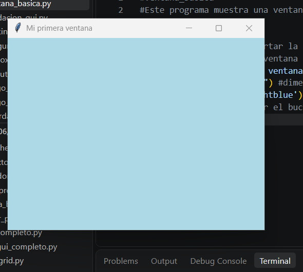

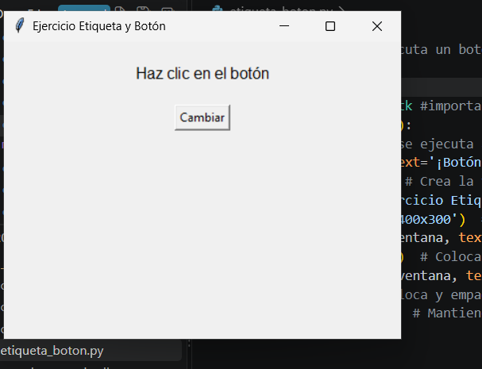

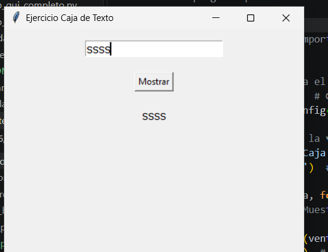

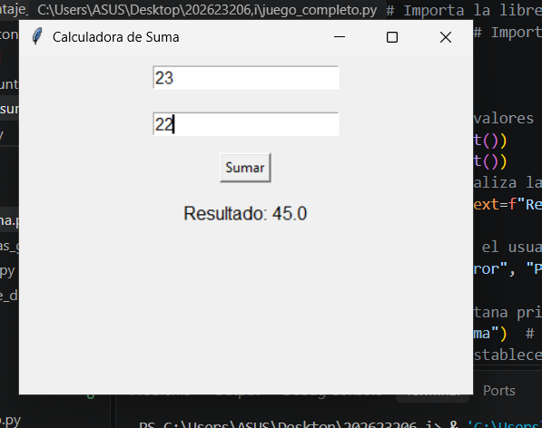

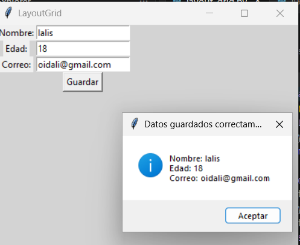

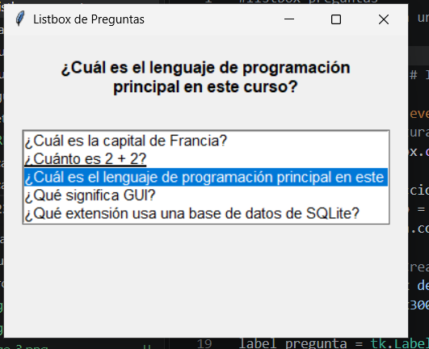

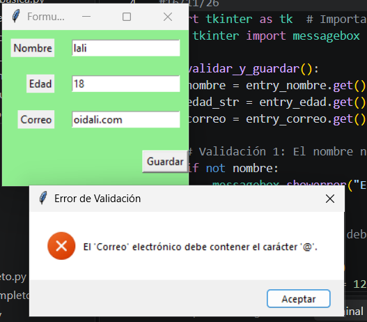

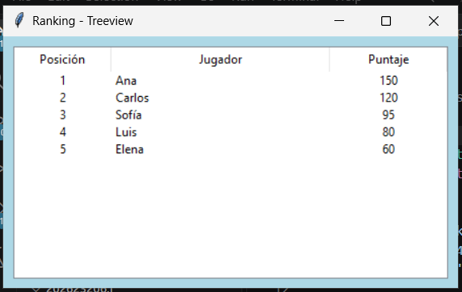

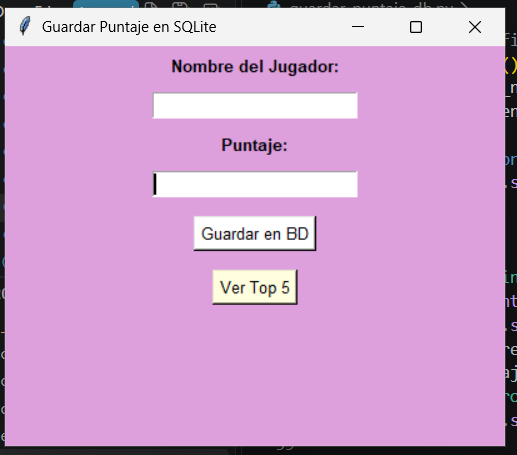

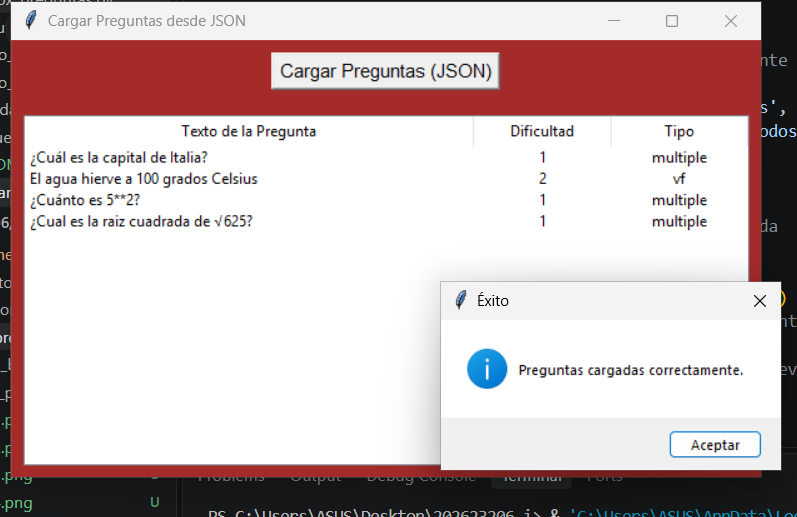

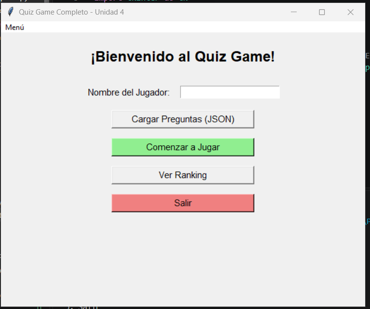